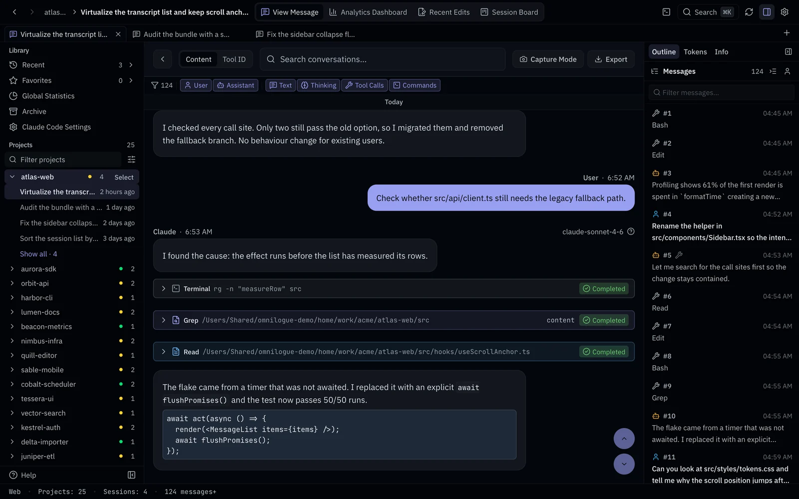

<div align="center">
  
  <h1>Omnilogue</h1>
</div>

**AI コーディングの履歴を、ひとつの場所に。**

Claude Code、Codex CLI、Cursor、GitHub Copilot など、端末にすでに保存されたセッションを検索して振り返れます。Omnilogue はオープンソースのデスクトップアプリで、セルフホスト WebUI も利用できます。

[ダウンロード](https://github.com/jhlee0409/omnilogue/releases/latest) · [公式サイトとスクリーンショット](https://jhlee0409.github.io/omnilogue/?lang=ja) · [変更履歴](CHANGELOG.md)

[English](README.md) · [한국어](README.ko.md) · [日本語](README.ja.md) · [简体中文](README.zh-CN.md) · [繁體中文](README.zh-TW.md)



## インストール

**macOS**（Apple シリコンと Intel）、**Windows**（x64）、**Linux**（x86-64）の[デスクトップ版を選択](https://jhlee0409.github.io/omnilogue/?lang=ja#downloads)できます。既存のアプリは、お気に入りと設定を保持したまま更新できます。

macOS では [Homebrew](docs/HOMEBREW.md) からもインストールできます。

```sh
brew install --cask jhlee0409/tap/omnilogue
```

Flatpak などのパッケージは [Linux ガイド](LINUX_BUILD.md#flatpak)を参照してください。

## 主な機能

- **必要な会話を見つける。** プロジェクトやツールごとに履歴を表示し、セッションを横断して検索できます。
- **作業の流れを振り返る。** 会話の分岐や各ステップをたどり、ツール呼び出しとファイル編集を確認できます。
- **使用量を把握する。** ログに必要な情報があれば、トークン使用量、推定 API コスト、サブエージェントの活動を確認できます。
- **履歴はローカルに。** デスクトップアプリは端末の会話ファイルを読み取り、履歴のアップロードや Omnilogue のアカウントを必要としません。

<a name="core"></a>
<details>
<summary>対応ツールと履歴のソース</summary>

Aider、Amazon Q CLI、Antigravity、Claude Code、claude.ai アカウントのエクスポート、Cline（Roo Code を含む）、CodeBuddy Code、Codex CLI、Continue.dev、Crush、Cursor（Cursor Agent と Cursor ACP を含む）、ForgeCode、Gemini CLI、GitHub Copilot、Goose、Grok CLI、Hermes Agent、Kilo Code、Kimi、Kiro、llm、Mistral Vibe、oh-my-pi、Open Interpreter、OpenCode、OpenHands、PearAI、Pi、Qoder、Qwen Code、Trae、Z Code、Zed。

</details>

## サーバーモード（WebUI）

ブラウザーで閲覧したい場合は、自分の環境でサーバーを起動してください。以下は同じ端末からのみ接続できる例です。

```sh
brew install jhlee0409/tap/cchv-server
cchv-server --serve --host 127.0.0.1
```

`http://127.0.0.1:3727` を開きます。ビルド済みバイナリ、Docker、ネットワーク接続時の認証は[サーバーガイド](docs/server-guide.md)を参照してください。

## ソースからビルド

Node.js 20.19+（または 22.12+）、pnpm、安定版 Rust が必要です。Linux では[ビルドの前提条件](LINUX_BUILD.md)も参照してください。

```sh
git clone https://github.com/jhlee0409/omnilogue.git
cd omnilogue
pnpm install
pnpm tauri:dev
```

デスクトップアプリをパッケージ化するには `pnpm tauri:build` を実行します。

## プロジェクトリンク

[セッションボードガイド](docs/USER_GUIDE.md) · [問題を報告](https://github.com/jhlee0409/omnilogue/issues) · [MIT ライセンス](LICENSE)

Omnilogue は独立したプロジェクトであり、履歴を読み取る各ツールの提供元との提携はありません。
