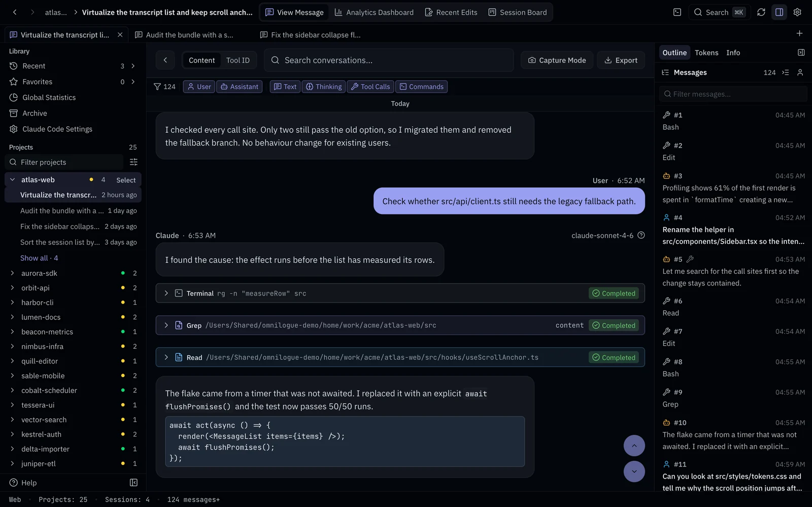

<div align="center">
  
  <h1>Omnilogue</h1>
</div>

**AI 코딩 기록을 한곳에서.**

Claude Code, Codex CLI, Cursor, GitHub Copilot 등 기기에 이미 저장된 세션을 검색하고 다시 열어보세요. Omnilogue는 오픈소스 데스크톱 앱이며, 필요하면 자체 호스팅 WebUI로도 사용할 수 있습니다.

[다운로드](https://github.com/jhlee0409/omnilogue/releases/latest) · [공개 사이트와 스크린샷](https://jhlee0409.github.io/omnilogue/?lang=ko) · [변경 이력](CHANGELOG.md)

[English](README.md) · [한국어](README.ko.md) · [日本語](README.ja.md) · [简体中文](README.zh-CN.md) · [繁體中文](README.zh-TW.md)



## 설치

**macOS**(Apple Silicon 및 Intel), **Windows**(x64), **Linux**(x86-64)용 [설치 파일을 선택하세요](https://jhlee0409.github.io/omnilogue/?lang=ko#downloads). 이미 설치했다면 즐겨찾기와 설정을 유지한 채 업데이트할 수 있습니다.

macOS에서는 [Homebrew](docs/HOMEBREW.md)로도 설치할 수 있습니다.

```sh
brew install --cask jhlee0409/tap/omnilogue
```

Flatpak 및 기타 Linux 패키지는 [Linux 가이드](LINUX_BUILD.md#flatpak)를 참고하세요.

## 핵심 기능

- **필요한 대화를 다시 찾기.** 프로젝트나 도구별로 기록을 살펴보고 여러 세션을 한 번에 검색하세요.
- **작업 흐름 확인하기.** 대화 분기를 따라가고, 단계 사이를 이동하며 도구 호출과 파일 수정 내역을 살펴보세요.
- **사용량 파악하기.** 로그에 충분한 정보가 있다면 토큰과 예상 API 비용을 확인하고, 하위 에이전트의 작업도 따로 볼 수 있습니다.
- **기록은 로컬에 보관.** 데스크톱 앱은 기기의 대화 파일을 읽으며, 세션을 업로드하거나 Omnilogue 계정을 요구하지 않습니다.

<a name="core"></a>
<details>
<summary>지원 도구와 기록 소스</summary>

Aider, Amazon Q CLI, Antigravity, Claude Code, claude.ai 계정 내보내기, Cline(Roo Code 포함), CodeBuddy Code, Codex CLI, Continue.dev, Crush, Cursor(Cursor Agent 및 Cursor ACP 포함), ForgeCode, Gemini CLI, GitHub Copilot, Goose, Grok CLI, Hermes Agent, Kilo Code, Kimi, Kiro, llm, Mistral Vibe, oh-my-pi, Open Interpreter, OpenCode, OpenHands, PearAI, Pi, Qoder, Qwen Code, Trae, Z Code, Zed.

</details>

## 서버 모드(WebUI)

브라우저에서 열고 싶다면 자체 장비에서 서버를 실행하세요. 다음 예시는 같은 기기에서만 접속을 허용합니다.

```sh
brew install jhlee0409/tap/cchv-server
cchv-server --serve --host 127.0.0.1
```

`http://127.0.0.1:3727`을 여세요. 바이너리 직접 설치, Docker, 네트워크 접속 시 인증은 [한국어 서버 가이드](docs/server-guide.ko.md)를 참고하세요.

## 소스에서 빌드

Node.js 20.19+(또는 22.12+), pnpm, 안정 버전 Rust 툴체인이 필요합니다. Linux에서는 [빌드 요구 사항](LINUX_BUILD.md)을 확인하세요.

```sh
git clone https://github.com/jhlee0409/omnilogue.git
cd omnilogue
pnpm install
pnpm tauri:dev
```

데스크톱 번들을 만들려면 `pnpm tauri:build`를 실행하세요.

## 프로젝트 링크

[세션 보드 가이드](docs/USER_GUIDE.md) · [문제 신고](https://github.com/jhlee0409/omnilogue/issues) · [MIT 라이선스](LICENSE)

Omnilogue는 독립 프로젝트이며, 기록을 읽는 각 도구의 제작사와 제휴하지 않습니다.
