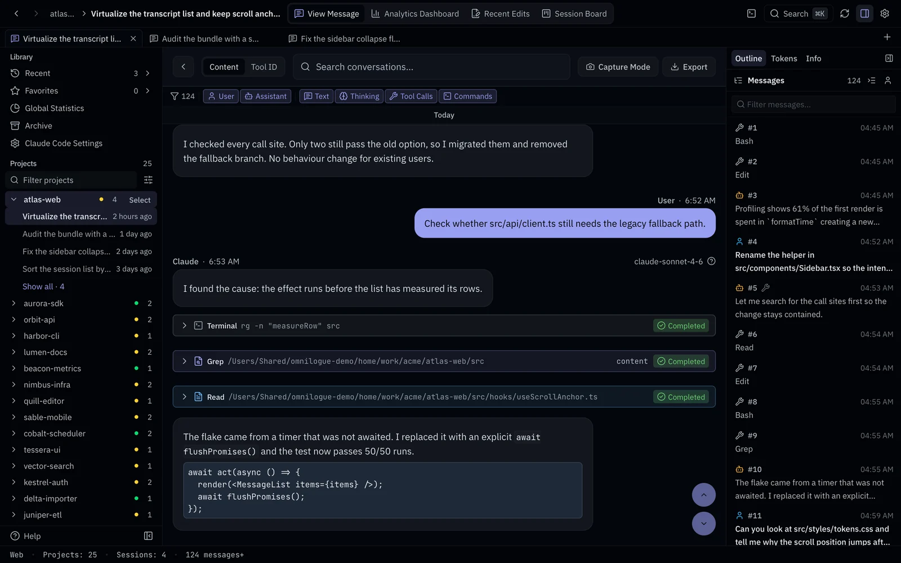

<div align="center">
  
  <h1>Omnilogue</h1>
</div>

**Your AI coding history, in one place.**

Search and revisit sessions already on your machine, from Claude Code, Codex CLI, Cursor, GitHub Copilot, and more. Omnilogue is an open-source desktop app with an optional self-hosted WebUI.

[Download](https://github.com/jhlee0409/omnilogue/releases/latest) · [Website and screenshots](https://jhlee0409.github.io/omnilogue/) · [Changelog](CHANGELOG.md)

[English](README.md) · [한국어](README.ko.md) · [日本語](README.ja.md) · [简体中文](README.zh-CN.md) · [繁體中文](README.zh-TW.md)



## Installation

[Choose a desktop download](https://jhlee0409.github.io/omnilogue/#downloads) for **macOS** (Apple silicon and Intel), **Windows** (x64), or **Linux** (x86-64). Existing installs can update in place and keep their favorites and settings.

On macOS, you can also install with [Homebrew](docs/HOMEBREW.md):

```sh
brew install --cask jhlee0409/tap/omnilogue
```

For Flatpak and other Linux packages, see the [Linux guide](LINUX_BUILD.md#flatpak).

## Features

- **Find a conversation again.** Browse by project or assistant and search across sessions.
- **Review what happened.** Follow conversation branches, jump between steps, and inspect tool calls and file edits.
- **Understand usage.** Review tokens and estimated API costs where the logs provide enough data, with separate visibility into subagent work.
- **Keep history local.** The desktop app reads conversation files on disk; it does not upload session data or require an Omnilogue account.

<a name="core"></a>
<details>
<summary>Supported assistants and history sources</summary>

Aider, Amazon Q CLI, Antigravity, Claude Code, claude.ai account exports, Cline (including Roo Code), CodeBuddy Code, Codex CLI, Continue.dev, Crush, Cursor (including Cursor Agent and Cursor ACP), ForgeCode, Gemini CLI, GitHub Copilot, Goose, Grok CLI, Hermes Agent, Kilo Code, Kimi, Kiro, llm, Mistral Vibe, oh-my-pi, Open Interpreter, OpenCode, OpenHands, PearAI, Pi, Qoder, Qwen Code, Trae, Z Code, and Zed.

</details>

## Server Mode (WebUI)

Want to use a browser? Run the optional server on your own machine. This example binds it to loopback only:

```sh
brew install jhlee0409/tap/cchv-server
cchv-server --serve --host 127.0.0.1
```

Open `http://127.0.0.1:3727`. See the [server guide](docs/server-guide.md) for prebuilt binaries, Docker, and authentication for network access.

## Build from Source

Requires Node.js 20.19+ (or 22.12+), pnpm, and a stable Rust toolchain. On Linux, see the [build prerequisites](LINUX_BUILD.md).

```sh
git clone https://github.com/jhlee0409/omnilogue.git
cd omnilogue
pnpm install
pnpm tauri:dev
```

Run `pnpm tauri:build` to create a desktop bundle.

## Project links

[Session Board guide](docs/USER_GUIDE.md) · [Report an issue](https://github.com/jhlee0409/omnilogue/issues) · [MIT License](LICENSE)

Omnilogue is an independent project and is not affiliated with the assistants whose history it reads.
