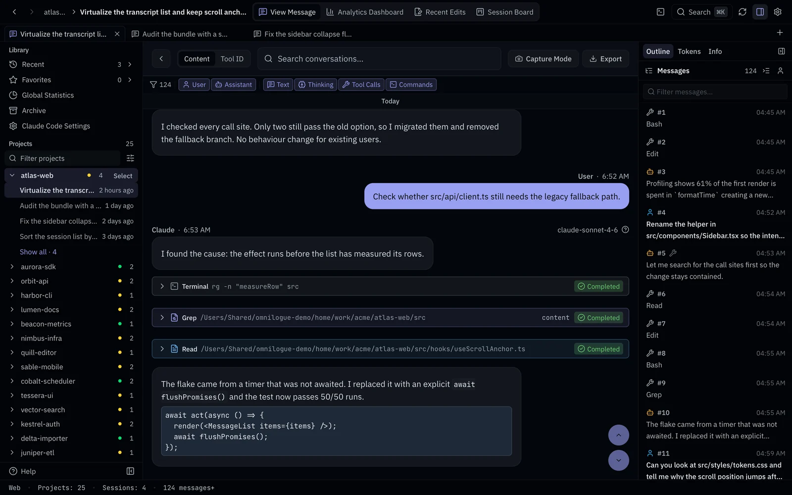

<div align="center">
  
  <h1>Omnilogue</h1>
</div>

**你的 AI 编程记录，集中一处。**

搜索并回看设备上已有的 Claude Code、Codex CLI、Cursor、GitHub Copilot 等工具的会话。Omnilogue 是开源桌面应用，也提供可选的自托管 WebUI。

[下载](https://github.com/jhlee0409/omnilogue/releases/latest) · [官网与截图](https://jhlee0409.github.io/omnilogue/?lang=zh-CN) · [更新日志](CHANGELOG.md)

[English](README.md) · [한국어](README.ko.md) · [日本語](README.ja.md) · [简体中文](README.zh-CN.md) · [繁體中文](README.zh-TW.md)



## 安装

为 **macOS**（Apple 芯片和 Intel）、**Windows**（x64）或 **Linux**（x86-64）[选择桌面安装包](https://jhlee0409.github.io/omnilogue/?lang=zh-CN#downloads)。已安装的用户可以直接更新，保留收藏和设置。

macOS 也可通过 [Homebrew](docs/HOMEBREW.md) 安装：

```sh
brew install --cask jhlee0409/tap/omnilogue
```

Flatpak 和其他 Linux 安装包见 [Linux 指南](LINUX_BUILD.md#flatpak)。

## 核心功能

- **找回需要的对话。** 按项目或工具浏览记录，跨会话搜索。
- **回顾工作过程。** 沿着对话分支回看，在步骤间跳转，检查工具调用和文件修改。
- **了解用量。** 日志信息充分时，可查看词元用量和预估 API 费用，也能单独查看子代理的活动。
- **记录保留在本地。** 桌面应用直接读取本地会话文件，不上传记录，也不要求注册 Omnilogue 账号。

<a name="core"></a>
<details>
<summary>支持的工具和记录来源</summary>

Aider、Amazon Q CLI、Antigravity、Claude Code、claude.ai 账号导出、Cline（含 Roo Code）、CodeBuddy Code、Codex CLI、Continue.dev、Crush、Cursor（含 Cursor Agent 和 Cursor ACP）、ForgeCode、Gemini CLI、GitHub Copilot、Goose、Grok CLI、Hermes Agent、Kilo Code、Kimi、Kiro、llm、Mistral Vibe、oh-my-pi、Open Interpreter、OpenCode、OpenHands、PearAI、Pi、Qoder、Qwen Code、Trae、Z Code 和 Zed。

</details>

## 服务器模式（WebUI）

如果希望通过浏览器查看，请在自己的设备上运行服务器。以下示例仅允许本机访问：

```sh
brew install jhlee0409/tap/cchv-server
cchv-server --serve --host 127.0.0.1
```

打开 `http://127.0.0.1:3727`。预编译程序、Docker 和网络访问认证请参考[服务器指南](docs/server-guide.md)。

## 从源码构建

需要 Node.js 20.19+（或 22.12+）、pnpm 和稳定版 Rust 工具链。Linux 用户请查看[构建要求](LINUX_BUILD.md)。

```sh
git clone https://github.com/jhlee0409/omnilogue.git
cd omnilogue
pnpm install
pnpm tauri:dev
```

运行 `pnpm tauri:build` 可打包桌面应用。

## 项目链接

[会话看板指南](docs/USER_GUIDE.md) · [报告问题](https://github.com/jhlee0409/omnilogue/issues) · [MIT 许可证](LICENSE)

Omnilogue 是独立项目，与这些工具的提供方没有隶属或合作关系。
