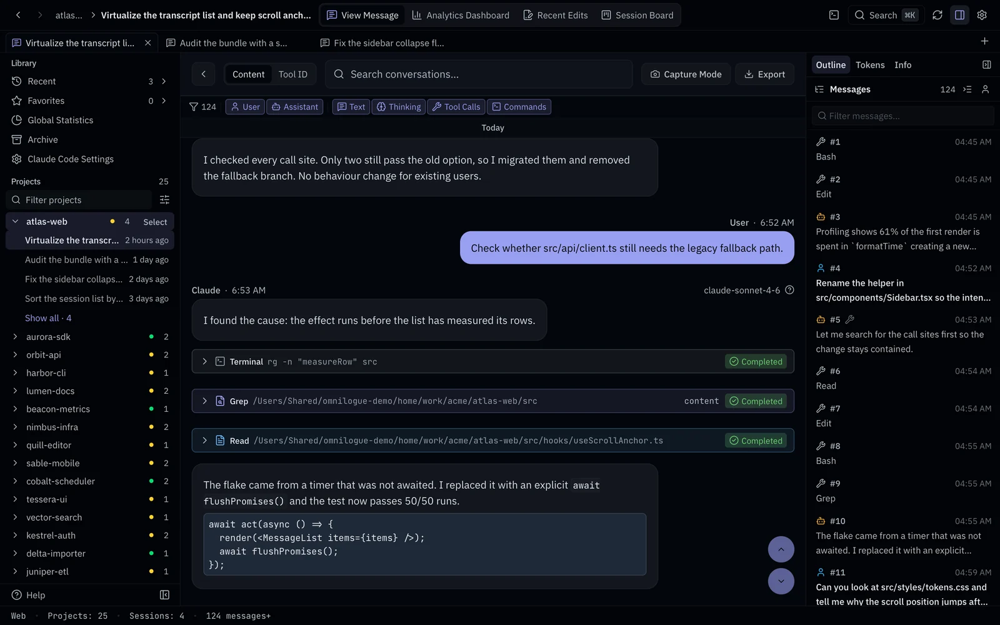

<div align="center">
  
  <h1>Omnilogue</h1>
</div>

**你的 AI 程式開發紀錄，集中一處。**

搜尋並回顧裝置上已有的 Claude Code、Codex CLI、Cursor、GitHub Copilot 等工具的工作階段。Omnilogue 是開放原始碼的桌面應用程式，也提供可自行託管的 WebUI。

[下載](https://github.com/jhlee0409/omnilogue/releases/latest) · [官方網站與畫面截圖](https://jhlee0409.github.io/omnilogue/?lang=zh-TW) · [版本紀錄](CHANGELOG.md)

[English](README.md) · [한국어](README.ko.md) · [日本語](README.ja.md) · [简体中文](README.zh-CN.md) · [繁體中文](README.zh-TW.md)



## 安裝

為 **macOS**（Apple 晶片與 Intel）、**Windows**（x64）或 **Linux**（x86-64）[選擇桌面安裝檔](https://jhlee0409.github.io/omnilogue/?lang=zh-TW#downloads)。已安裝的使用者可以直接更新，保留收藏和設定。

macOS 也可透過 [Homebrew](docs/HOMEBREW.md) 安裝：

```sh
brew install --cask jhlee0409/tap/omnilogue
```

Flatpak 和其他 Linux 套件請參考 [Linux 指南](LINUX_BUILD.md#flatpak)。

## 核心功能

- **找回需要的對話。** 依專案或工具瀏覽紀錄，跨工作階段搜尋。
- **回顧工作脈絡。** 沿著對話分支回顧，在步驟間跳轉，檢視工具呼叫和檔案修改。
- **掌握用量。** 紀錄資訊充足時，可查看權杖用量和預估 API 費用，也能個別查看子代理的活動。
- **紀錄保留在本機。** 桌面應用程式直接讀取本機對話檔案，不上傳紀錄，也不要求註冊 Omnilogue 帳號。

<a name="core"></a>
<details>
<summary>支援的工具和紀錄來源</summary>

Aider、Amazon Q CLI、Antigravity、Claude Code、claude.ai 帳號匯出、Cline（含 Roo Code）、CodeBuddy Code、Codex CLI、Continue.dev、Crush、Cursor（含 Cursor Agent 和 Cursor ACP）、ForgeCode、Gemini CLI、GitHub Copilot、Goose、Grok CLI、Hermes Agent、Kilo Code、Kimi、Kiro、llm、Mistral Vibe、oh-my-pi、Open Interpreter、OpenCode、OpenHands、PearAI、Pi、Qoder、Qwen Code、Trae、Z Code 和 Zed。

</details>

## 伺服器模式（WebUI）

要從瀏覽器檢視，請在自己的裝置上執行伺服器。以下範例僅允許同一台裝置連線：

```sh
brew install jhlee0409/tap/cchv-server
cchv-server --serve --host 127.0.0.1
```

開啟 `http://127.0.0.1:3727`。預先編譯的執行檔、Docker 和網路存取驗證請參考[伺服器指南](docs/server-guide.md)。

## 從原始碼建置

需要 Node.js 20.19+（或 22.12+）、pnpm 和穩定版 Rust 工具鏈。Linux 使用者請查看[建置需求](LINUX_BUILD.md)。

```sh
git clone https://github.com/jhlee0409/omnilogue.git
cd omnilogue
pnpm install
pnpm tauri:dev
```

執行 `pnpm tauri:build` 可建立桌面應用程式套件。

## 專案連結

[工作階段看板指南](docs/USER_GUIDE.md) · [回報問題](https://github.com/jhlee0409/omnilogue/issues) · [MIT 授權](LICENSE)

Omnilogue 是獨立專案，與這些工具的提供者沒有隸屬或合作關係。
