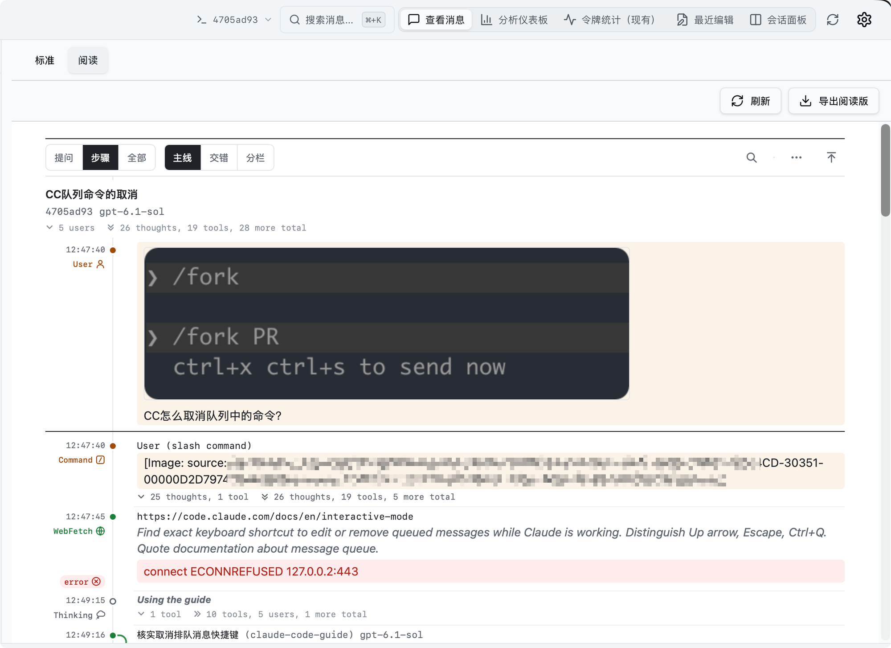

# Optional Claude reading mode

Reading mode is an alternative transcript surface, not a replacement for the
standard viewer. Select **Standard / Reading** above a Claude conversation.
Standard is the default; the preference is persisted. Other providers use the
standard viewer without resetting the saved preference.



The screenshot was supplied by the contributor with local paths redacted. The
red `ECONNREFUSED` row belongs to the displayed historical conversation; it is
not a failure of the reading viewer. It shows the pre-rebase local build, so the
surrounding application shell may differ from current `develop`.

## Renderer requirement

The application does not download or install a renderer. Reading mode requires
a trusted, separately installed `claude-code-log` executable that reports
`version 1.7.0` and implements the following command:

```sh
claude-code-log convert /absolute/path/to/session.jsonl \
  --theme minimal --depth hook --format html \
  --image-export-mode embedded --output - --no-cache
```

The revision actually exercised during development is
[`daaain/claude-code-log@9834d25c88dc4dbe8f8ade40ae4b74602ae7669d`](https://github.com/daaain/claude-code-log/commit/9834d25c88dc4dbe8f8ade40ae4b74602ae7669d),
whose package version is 1.7.0. This is **not** a claim that every release or
revision reporting that version has the same CLI, scripts or sidecar support.
In particular, the historical `1.7.0` Git tag is not the tested revision.

Install the trusted revision yourself using your preferred Python tool manager,
for example:

```sh
uv tool install 'git+https://github.com/daaain/claude-code-log.git@9834d25c88dc4dbe8f8ade40ae4b74602ae7669d'
```

The executable is discovered through absolute entries in `PATH`, then
`~/.local/bin`. For another location, set `CCHV_READING_RENDERER` to its absolute
executable path before starting the application/server. Python and the renderer
are not bundled. A missing or incompatible renderer leaves Standard available
and displays a retryable error.

## Source contract and producer evidence

The host stages authorized raw JSONL files and sidecars into a temporary
snapshot; it does not reconstruct a transcript from normalized, filtered or
paginated frontend messages. Continuations use the application's existing
session-chain resolver. This adapter follows the **tested renderer's** discovery
contract, not an assertion that every Claude Code version/fork emits it:

- Agent linking and legacy-sibling / `<session>/subagents` discovery:
  [converter.py@9834d25:716–766](https://github.com/daaain/claude-code-log/blob/9834d25c88dc4dbe8f8ade40ae4b74602ae7669d/claude_code_log/converter.py#L716-L766).
- `agent-<id>.meta.json` → `toolUseId` relationships:
  [converter.py@9834d25:834–875](https://github.com/daaain/claude-code-log/blob/9834d25c88dc4dbe8f8ade40ae4b74602ae7669d/claude_code_log/converter.py#L834-L875).
- Workflow journal, agent side channels and terminal snapshot layout:
  [workflow.py@9834d25:1–25](https://github.com/daaain/claude-code-log/blob/9834d25c88dc4dbe8f8ade40ae4b74602ae7669d/claude_code_log/workflow.py#L1-L25),
  including snapshot-only runs:
  [workflow.py@9834d25:368–405](https://github.com/daaain/claude-code-log/blob/9834d25c88dc4dbe8f8ade40ae4b74602ae7669d/claude_code_log/workflow.py#L368-L405).

Only loader identifiers used in discovery are validated as identifiers;
application data with similarly named keys remains data. Unsupported shapes
are not promoted into invented relationships. Traversal-like identifiers,
symlinks, sources outside configured history roots and conflicting staged
sidecars fail closed. Original history files are not modified.

## Document boundary

- Desktop IPC and WebUI expose the same preparation/export commands.
- Each prepared document has a random, expiring capability and bridge nonce;
  document URLs never contain the application's global authentication token.
- The iframe allows scripts but not same-origin access. Each document response
  has its own CSP with inline-script hashes derived from a trivial render made
  by the same trusted executable. Unexpected scripts are rejected. This is not
  a sandbox for an untrusted renderer executable: install only trusted code.
- Remote scripts/assets, network polling and the upstream CDN timeline are not
  enabled. The host application's script policy is unchanged.
- At most four expiring documents are retained, with input/output and process
  limits. Refresh generates a fresh snapshot rather than using a cross-request
  render cache. Renderer subprocesses have a bounded deadline and child-process
  cleanup.

## First-pass behavior and limitations

- Manual refresh; no incremental live updates.
- Reading supports theme/font appearance, UUID targets, prompt/step controls,
  upstream search/filtering, agent branch views and standalone HTML export.
- Standard navigator/filter/capture surfaces are hidden while reading. Standard
  rendering itself is preserved. Search occurrence parity is not promised.
- New host controls are localized in all five application languages; some
  inherited renderer labels remain in the renderer's language.
- Validation before rebasing included real WebUI preparation/document/export,
  macOS Tauri reading interactions, continuation+Agent display and standalone
  browser export. macOS native export reached the Save panel but file save was
  not verified. These results do not substitute for checking the rebased UI.
- Windows/Linux reading-runtime interaction, large-session memory/performance,
  and deep workflow/fork edge cases remain to be validated. Normal application
  launch CI is not a reading-mode end-to-end test.
